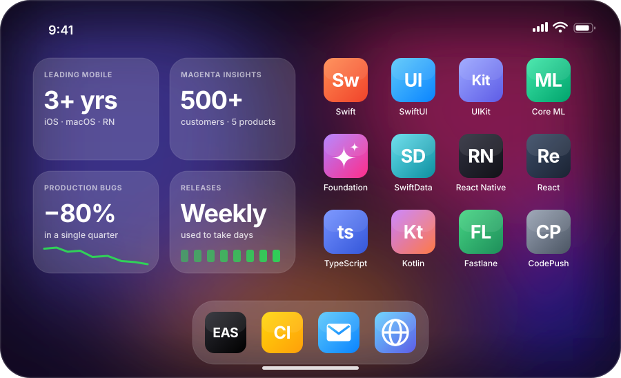

 

<picture><source media="(prefers-color-scheme: dark)" srcset="assets/imessage-dark.svg"></picture>

 

### Apps

<a href="https://omgandhi.dev"><picture><source media="(prefers-color-scheme: dark)" srcset="assets/app-nova-key-dark.svg"></picture></a>
<a href="https://omgandhi.dev"><picture><source media="(prefers-color-scheme: dark)" srcset="assets/app-oink-dark.svg"></picture></a>
<a href="https://omgandhi.dev"><picture><source media="(prefers-color-scheme: dark)" srcset="assets/app-translo-dark.svg"></picture></a>

 

### Home Screen

 

### Activity

<picture><source media="(prefers-color-scheme: dark)" srcset="https://raw.githubusercontent.com/Omgandhi18/Omgandhi18/output/activity-dark.svg"></picture>

 

### Contact

<picture><source media="(prefers-color-scheme: dark)" srcset="assets/contact-dark.svg"></picture>

<a href="mailto:omkgandhi@outlook.com"><picture><source media="(prefers-color-scheme: dark)" srcset="assets/button-mail-dark.svg"></picture></a>&nbsp;&nbsp;<a href="https://omgandhi.dev"><picture><source media="(prefers-color-scheme: dark)" srcset="assets/button-web-dark.svg"></picture></a>

