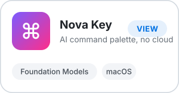
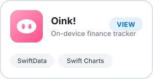
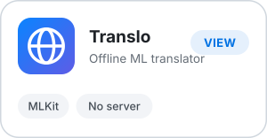

  <b>iOS · macOS · React Native · On-device AI</b> 
  Ahmedabad, India · Remote · Open to visa sponsorship 
  <a href="https://omgandhi.dev">omgandhi.dev</a> · <a href="mailto:omkgandhi@outlook.com">omkgandhi@outlook.com</a>

 

### I build mobile products that ship and stay shipped.

3+ years leading iOS, macOS, and cross-platform engineering. Right now I own a 5-product B2B SaaS suite at [Magenta Insights](https://magentainsights.com), used by 500+ business customers.

- **~80% fewer production bugs** in one quarter
- **Multi-day release cycles → continuous weekly shipping**
- **On-device AI** is my thing: features that run fully local, protect privacy, and cost nothing to serve

 

### Selected work

  <a href="https://omgandhi.dev"><picture><source media="(prefers-color-scheme: dark)" srcset="assets/card-nova-key-dark.svg"></picture></a>
  <a href="https://omgandhi.dev"><picture><source media="(prefers-color-scheme: dark)" srcset="assets/card-oink-dark.svg"></picture></a>
  <a href="https://omgandhi.dev"><picture><source media="(prefers-color-scheme: dark)" srcset="assets/card-translo-dark.svg"></picture></a>

 

### Stack

| Apple | Cross-platform | Shipping |
| :-- | :-- | :-- |
| Swift · SwiftUI · UIKit | React Native · React | Fastlane · CodePush |
| CoreML · Foundation Models · SwiftData | TypeScript · Kotlin | EAS · CI/CD |

 

### My contribution graph, eaten fresh every night

<picture>
  <source media="(prefers-color-scheme: dark)" srcset="https://raw.githubusercontent.com/Omgandhi18/Omgandhi18/output/github-snake-dark.svg">
  
</picture>

  

  Open to <b>Senior iOS</b>, <b>Lead Mobile</b>, and <b>Senior Frontend</b> roles.

  <a href="mailto:omkgandhi@outlook.com"><picture><source media="(prefers-color-scheme: dark)" srcset="assets/say-hi-dark.svg"></picture></a>

